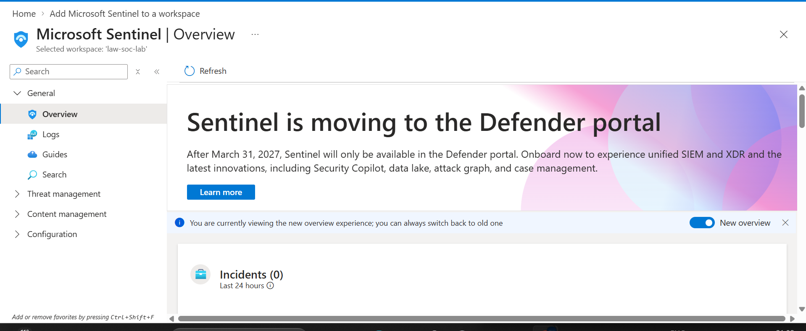
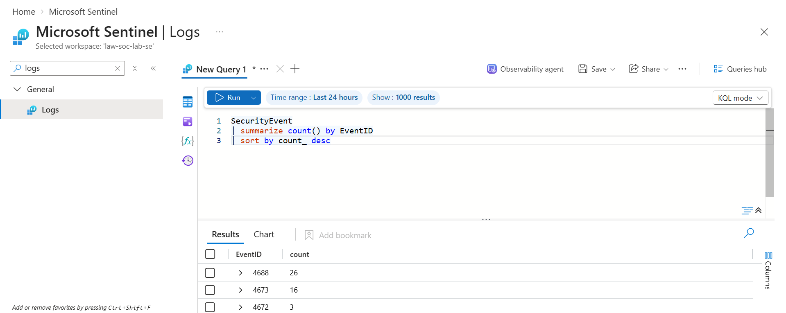
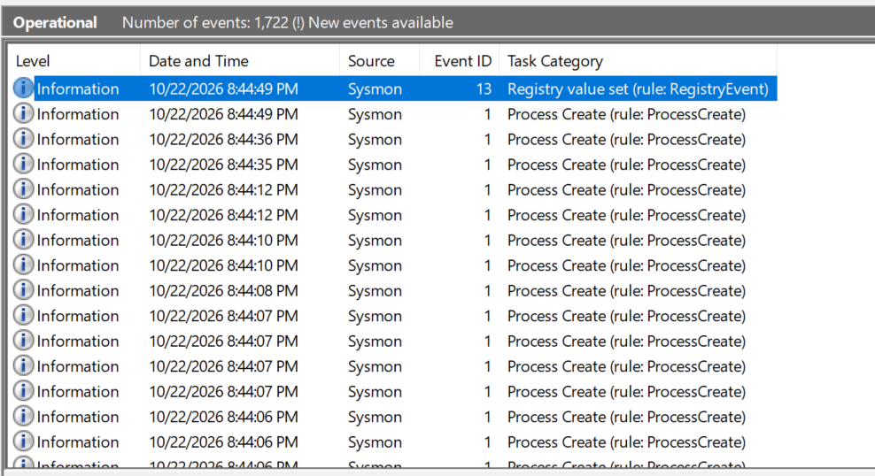
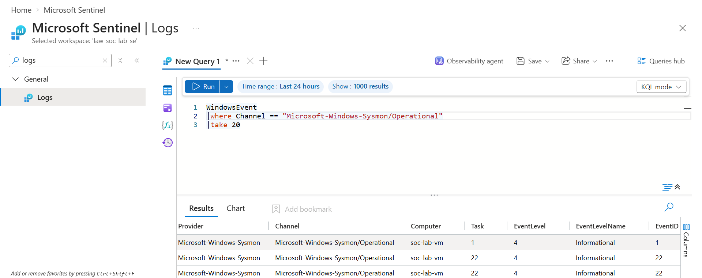
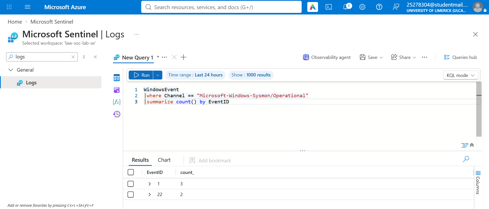
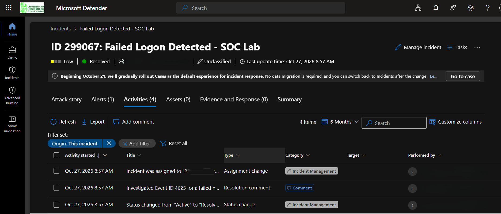

# Microsoft Sentinel SOC Home Lab

## Overview

This project documents a hands-on Security Operations Centre (SOC) lab built using Microsoft Sentinel and an Azure-hosted Windows Server virtual machine.

The lab focused on collecting Windows Security and Sysmon telemetry, analysing events with Kusto Query Language (KQL), creating a scheduled analytics rule for failed logons, and investigating the resulting incident through the Microsoft Sentinel incident workflow.

The objective was to practise the core Tier 1 SOC process:

**Collect logs → Query events → Detect suspicious activity → Generate an alert → Investigate → Classify and close the incident**

---

## Lab Architecture

```
Windows Server VM
      │
      ├── Windows Security Event Logs
      │
      └── Sysmon Telemetry
              │
              ▼
     Azure Monitor Agent
              │
              ▼
     Data Collection Rules
              │
              ▼
     Log Analytics Workspace
              │
              ▼
       Microsoft Sentinel
              │
        ┌─────┴─────┐
        ▼           ▼
     KQL Queries   Analytics Rule
                        │
                        ▼
                      Alert
                        │
                        ▼
                     Incident
                        │
                        ▼
                Tier 1 Investigation
```

---

## Technologies Used

- Microsoft Azure
- Microsoft Sentinel
- Log Analytics Workspace
- Azure Monitor Agent
- Data Collection Rules
- Windows Server 2025
- Windows Event Viewer
- Sysmon
- Kusto Query Language (KQL)

---

## 1. Microsoft Sentinel Setup

Microsoft Sentinel was enabled on a Log Analytics workspace and connected to the Windows virtual machine.

The environment was configured to collect security telemetry that could later be queried and analysed from Sentinel.

### Sentinel Overview



---

## 2. Windows Security Event Collection

A Data Collection Rule was configured to collect Windows Security events from the monitored VM using the Azure Monitor Agent.

The following KQL query was used to verify that Windows Security events were reaching Sentinel:

```kusto
SecurityEvent
| summarize count() by EventID
| sort by count_ desc
```

This returned multiple Windows Security Event IDs, confirming that the log collection pipeline was working.

### Security Event Counts



---

## 3. Sysmon Installation and Monitoring

Sysmon was installed on the Windows Server VM to provide additional endpoint telemetry.

Sysmon records detailed system activity such as:

- Process creation
- Network connections
- File activity
- Other security-relevant endpoint events

The Sysmon Operational log was first verified locally using Windows Event Viewer.

### Sysmon Operational Events



A second Data Collection Rule was configured to forward the Sysmon Operational channel into Microsoft Sentinel.

The following query was used to verify ingestion:

```kusto
WindowsEvent
| where Channel == "Microsoft-Windows-Sysmon/Operational"
| take 20
```

### Sysmon Events in Sentinel



The events were also grouped by Event ID:

```kusto
WindowsEvent
| where Channel == "Microsoft-Windows-Sysmon/Operational"
| summarize count() by EventID
```

### Sysmon Event ID Summary



---

## 4. Failed Logon Detection

Windows Security Event ID **4625** represents a failed account logon.

The following KQL query was used to identify failed authentication attempts:

```kusto
SecurityEvent
| where EventID == 4625
| summarize Attempts = count() by TargetAccount, IpAddress
| sort by Attempts desc
```

A previously collected Event ID 4625 was identified in the Sentinel data.

The event represented a failed network authentication attempt and was later used to test the analytics and incident-response workflow.

---

## 5. Analytics Rule

A scheduled Microsoft Sentinel analytics rule was created:

**Failed Logon Detected - SOC Lab**

The rule searched for Windows Security Event ID 4625 and generated an alert when matching activity was found.

For the lab exercise, the rule used an extended lookback period so that the existing failed-logon event could be used to validate the complete alert and incident workflow.

This configuration was intended for learning purposes rather than as a production detection rule.

---

## 6. Incident Investigation

The analytics rule successfully generated a Microsoft Sentinel alert and incident.

The alert showed:

- Windows Security Event ID: **4625**
- Failed authentication attempt
- Target account information
- Source IP information
- Attempt count

The original Windows Security event was then investigated using KQL.

```kusto
SecurityEvent
| where EventID == 4625
| project TimeGenerated, Computer, TargetAccount, IpAddress, LogonType, Activity
| sort by TimeGenerated desc
```

The failed event had:

- **Event ID:** 4625
- **Logon Type:** 3
- **Activity:** An account failed to log on

Logon Type 3 represents a network logon.

Related successful authentication events were also reviewed using Event ID **4624**.

```kusto
SecurityEvent
| where TimeGenerated > ago(7d)
| where EventID in (4624, 4625)
| project TimeGenerated, EventID, Activity, TargetAccount, IpAddress, LogonType
| sort by TimeGenerated asc
```

The investigation identified only one failed authentication attempt associated with the detection. The available lab evidence was not sufficient to confirm brute-force activity or account compromise.

The incident was therefore closed without claiming confirmed malicious activity.

### Closed Incident



---

## SOC Skills Practised

This lab provided hands-on practice with:

- SIEM deployment and configuration
- Windows Security log analysis
- Sysmon telemetry
- Azure Monitor Agent
- Data Collection Rules
- KQL querying
- Authentication-event analysis
- Event ID 4624 and 4625 investigation
- Microsoft Sentinel analytics rules
- Alert generation
- Incident triage
- Evidence-based incident classification
- Tier 1 SOC investigation workflow

---

## Key Learning

One of the main lessons from this lab was the difference between an individual security event and a complete SOC detection workflow.

A Windows event by itself does not automatically represent an attack.

The analyst must correlate the event with additional evidence, determine its context, and avoid making conclusions that are not supported by the available telemetry.

The lab also demonstrated the progression from raw endpoint telemetry to a SIEM detection:

```
Endpoint activity
→ Windows/Sysmon logs
→ Log ingestion
→ KQL analysis
→ Analytics rule
→ Alert
→ Incident
→ Analyst investigation
```

---

## Future Improvements

The lab can be extended by:

- Creating controlled repeated failed logon activity
- Developing a threshold-based brute-force detection rule
- Correlating failed and successful authentication attempts
- Adding entity mapping for accounts and IP addresses
- Mapping detections to MITRE ATT&CK
- Creating additional Sysmon detections
- Building automation rules and playbooks
- Adding dashboards and workbooks
- Testing additional SOC investigation scenarios

---

## Disclaimer

This project was created as a controlled cybersecurity learning environment.

All investigation findings and conclusions are limited to the telemetry available within the lab and are not presented as evidence of a real-world compromise.
